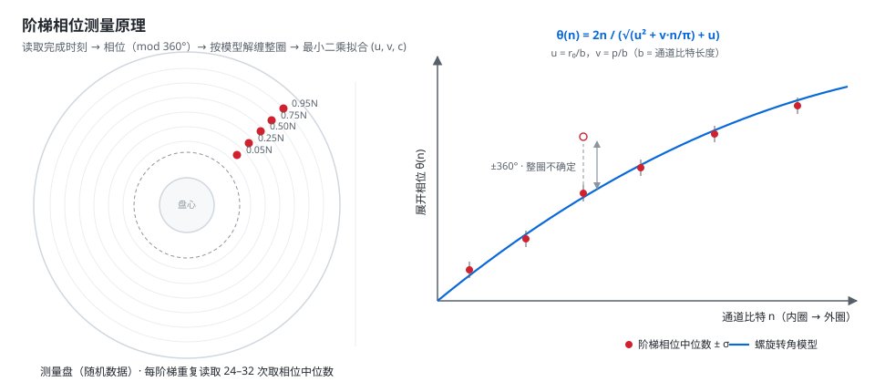
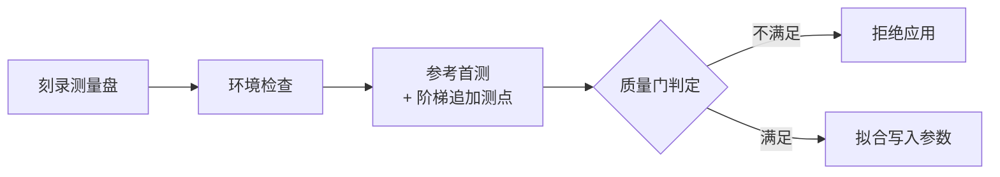
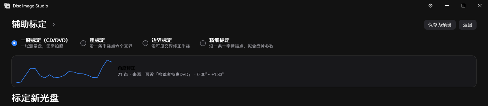
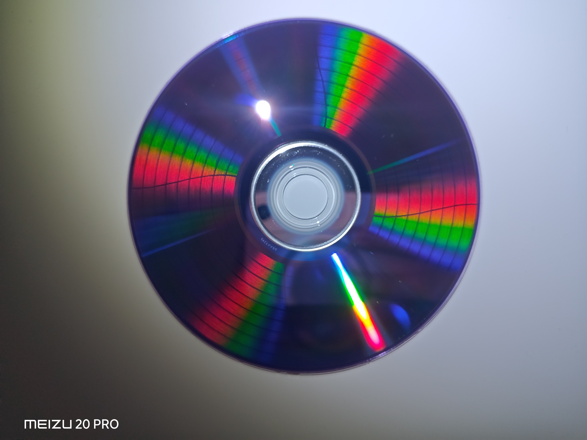
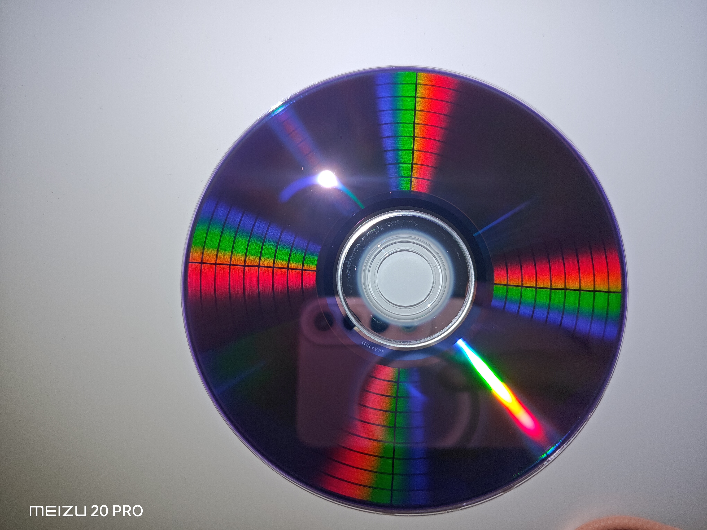
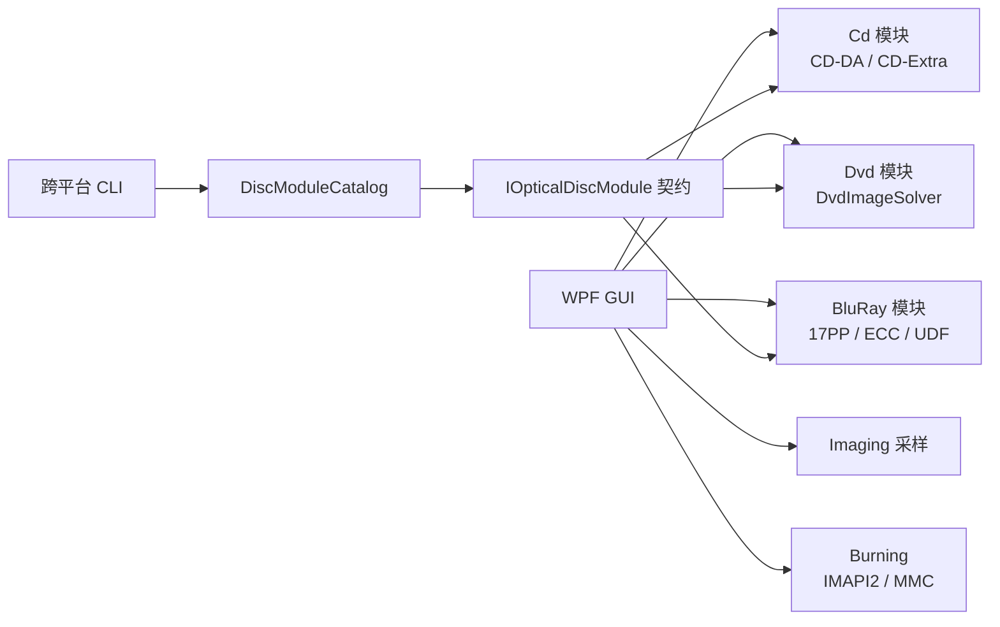

<div align="center">

# Disc Image Studio · 改进版

**把图像刻成光盘盘面可见图案 —— 一张盘完成 DVD 标定，角度修正看得见**

[](https://github.com/123RDST/DiscImageStudio/releases/tag/v1.6.11)

[](#9-开发与测试)
[](LICENSE)

[下载 Windows 版](https://github.com/123RDST/DiscImageStudio/releases/tag/v1.6.11) · [更新日志](CHANGELOG.md) · [标定详解](docs/CALIBRATION.md) · [实操教程](docs/CALIBRATION_TUTORIAL.md) · [验证记录](docs/VALIDATION.md)

</div>

> **这是非官方修改版。** 基于 [JiaFeiMiao-K-Cat/DiscImageStudio](https://github.com/JiaFeiMiao-K-Cat/DiscImageStudio) 修改，其上游为 [0xfed/DiscImageStudio](https://github.com/0xfed/DiscImageStudio)。本版与原作者无隶属关系，遵循 GPL-3.0-or-later；需要官方版本请前往上游仓库。

## 目录

1. [概述](#1-概述)
2. [工作原理](#2-工作原理)
   - [2.1 图案是如何刻进盘面的](#21-图案是如何刻进盘面的)
   - [2.2 螺旋几何模型](#22-螺旋几何模型)
   - [2.3 为什么必须标定](#23-为什么必须标定)
   - [2.4 一键标定：让光驱自己测量](#24-一键标定让光驱自己测量)
   - [2.5 三次轨距拟合](#25-三次轨距拟合)
   - [2.6 角度修正表](#26-角度修正表)
3. [实测数据](#3-实测数据)
4. [相比原项目改了什么](#4-相比原项目改了什么)
5. [一键标定怎么用](#5-一键标定怎么用)
6. [架构](#6-架构)
7. [下载与运行](#7-下载与运行)
8. [已知限制](#8-已知限制)
9. [开发与测试](#9-开发与测试)
10. [致谢与许可](#10-致谢与许可)

## 1. 概述

光盘刻录机的激光在盘面上留下明暗痕迹（mark），痕迹的疏密沿着螺旋轨道分布——控制每个位置写入的数据，就能让盘面呈现出肉眼可见的图案。本项目把这个原理工程化：图像经影调映射与采样，转换为 CD / DVD / BD 的扇区数据，导出镜像或直接刻录。

图案能不能对得准，取决于程序对**这张盘、这台光驱**真实几何的了解程度。原项目的标定流程需要拍照、描点、三个阶段反复换盘；本版的重点是把它换成**由光驱自己测量**，并让修正数据在界面上可见、可追溯：

- **一键标定（CD/DVD）**：刻一张随机数据测量盘，读回扇区相位，直接拟合内外半径与三次轨距分布，DVD 一张盘得到完整预设参数；
- **角度修正可视化**：修正表画成曲线，标明点数、来源与角度范围；没有表时明确警告外圈可能出现 U 形线；
- **CD 音乐 + 图片混合盘**：外圈整盘 DAO 与内圈 CD-Extra 两种布局，已在实体 CD 机上验证播放。

## 2. 工作原理

### 2.1 图案是如何刻进盘面的

光盘以恒定线速度（CLV）旋转，数据沿单条螺旋轨道写入。通道比特（channel bit）是轨道上最小的物理记录单位：

| 介质 | 通道比特长度 | 每扇区通道比特 | 备注 |
| --- | ---: | ---: | --- |
| CD | 1200 mm/s ÷ 4,321,800 Hz ≈ **0.278 µm** | 98 帧 × 588 bit = **57,624** | 读回位置换算含 108 帧导入区偏移 |
| DVD | **133.3 nm** | **38,688** | 按 16 扇区 ECC 块对齐读取 |
| BD | — | — | 17PP 调制、LDC-BIS 纠错，本版沿用上游引擎 |

生成器把图像沿螺旋按字节顺序写入：图像灰度决定扇区数据的调制结果，mark 密度形成可见明暗。影调模型（`ToneProfile`）统一管理抖动强度（0–100%）、sRGB 线性化、CD 灰阶档位与亮度，生成、流式刻录、读回预览共用同一份映射，保证「预览看到的就是刻出来的」。

### 2.2 螺旋几何模型

设通道比特长度为 `b`，从盘心数起的通道比特数为 `n`，则恒定轨距螺旋的解析几何为：

```
半径：r(n) = b · √(u² + v·n/π)
转角：θ(n) = 2n / (√(u² + v·n/π) + u)

其中 u = r₀/b（内半径），v = p/b（轨距），N = 总扇区数，β = 每扇区比特数
外半径：r₁ = b · √(u² + v·N·β/π)
```

实际盘片的轨距并非恒定。本项目用三次多项式描述其随归一化半径 `x = (r − r₀)/(r₁ − r₀)` 的变化：

```
p(x) = p₀ · (1 + c₁x + c₂x² + c₃x³)，p₀ 由总轨长 N·β 唯一确定
```

内外半径、容量与三个轨距系数**成套使用**：改了半径不配系数，图案立刻错位。

### 2.3 为什么必须标定

同一标称规格的盘片，实际刻录区边界可以差出 0.1 mm 量级（例：内置预设 23.9915 mm，实盘初始估计 24.1 mm，差 0.11 mm，按 DVD 0.74 µm 轨距折算约 150 圈轨道）。几何模型错一点，图案沿切向累积错位：

- **内外半径错** → 图案整体沿螺旋压缩/拉伸，同心圆图案偏心；
- **轨距形状错** → 细臂图案弯曲（原项目靠三轮粗标 + 边界 + 精标逐步消除）；
- **角度修正缺失** → 外圈出现 U 形线（见 [2.6](#26-角度修正表)）。

原项目用**图案标定**解决：刻已知图案 → 拍照 → 矫正 → 描点 → 反推参数，三个阶段（粗 / 边界 / 精细）至少消耗数张盘与大量手工操作。本版新增**计时标定**：不需要照片，只需要光驱自己读盘。

### 2.4 一键标定：让光驱自己测量

原理：对同一 LBA 反复读取，**读取完成时刻在盘片旋转周期内的相位**（mod 360°）是该位置螺旋转角的直接观测值。在多个半径处取阶梯测点、解缠整圈、最小二乘拟合，即可解出 `u、v` —— 半径与轨距被一次读回全部测出。



流程与质量门：



关键设计：

- **质量门（任一不满足即整体拒绝、不写参数）**：拟合 χ² ≤ 25、单点残差 ≤ 90°、≥ 8 测点、径向覆盖 ≥ 40%、残差 RMS ≤ 30°；转速一致性要求旋转周期在 3–400 ms 内；
- **缓存无法绕过时直接失败**：先在 5 个位置（0.05N–0.95N）测量读取耗时，判定光驱缓存策略（普通读 / FORCE UNIT ACCESS / 刷新缓存 / 逐出缓存，阈值 3 ms），绕不过就报错而不是给出错误结果；
- **整圈不确定的测点不测**：预测相位不确定度 > 25° 的位置跳过，避免把 ±360° 歧义带进拟合；
- **自适应选点**：约 1/3 的测点取「离已测点最远」以约束内半径，其余取「使轨距方差最小」以约束轨距形状；
- **计时拟合只给初值**：CD 存在未知沿轨偏移，应用后仍需第二张盘做图案精标；DVD 无此问题，可直接进入精细阶段。

### 2.5 三次轨距拟合

恒定轨距只是初值。三次轨距形状从**同一次测量**的解缠相位表恢复，无需刻第二张盘：

- 在内半径上做 8001 点网格扫描，形状项正则化 λ = 1e-3（仅防止测量区间外的边缘摆动）；
- **整圈自动修复**：RMS 超过 2.5× 噪声时，对残差最大的 6 个测点尝试 ±360° 重解缠，最多 8 轮；
- 拟合结果与 [Discratcher](https://github.com/POPCORNBOOM/Discratcher) 的真实 56 测点记录对照验证一致。

### 2.6 角度修正表

三次轨距多项式的拟合基**条件数约 126**——三个系数只能表达一族形状近似的曲线，测出的局部凸起无法通过径向拟合表达。因此本版把残余角度误差**直接以角度存储**：

| 属性 | 值 |
| --- | --- |
| 自变量 | 归一化半径 `x = (r − r₀)/(r₁ − r₀)` |
| 插值 | 单调三次 Hermite（PCHIP），无过冲 |
| 节点 | 最多 256 个，内圈加密（密度指数 2）、外圈稀疏（1.4） |
| 锚定 | `x = 0` 处为 0（整体旋转归起始角管理） |

角度误差的物理来源是**主轴偏心与转速误差**——与内外半径无关。历史上「应用一键标定结果时清空角度表」的做法是错的：表被清空后外圈重新出现 U 形线。本版（1.6.10 起）保留表，并在日志报告点数或「未标定」提醒。

界面上（1.6.11 起）角度表画成折线，来源可追溯：



卡片标注点数、**来源**（精细标定 + 时间戳 / 命名预设 / 工程文件）与角度范围，切换预设、重新标定或打开工程时曲线与来源同步更新。实测示例：`21 点 · 来源：预设「拾荒者特惠DVD」 · 0.00° ~ +1.33°`。

## 3. 实测数据

### 图案标定全程（Verbatim AZO DVD-R，2026-11-04）

完整记录（照片、取点、生成参数）见[实操教程](docs/CALIBRATION_TUTORIAL.md)。盘容量 2,297,888 扇区，位长 133.3 nm：

| 阶段 | 内半径 / mm | 外半径 / mm | 测量输入 |
| --- | ---: | ---: | --- |
| 初始估计 | 24.1000 | 57.8000 | — |
| 粗标定（宽带估值） | 24.0167 | 57.7092 | 沿半径 6 点 |
| 粗标定（角度标记修正） | 23.9958 | 57.9759 | 同上 + 带内 3 处条纹 |
| 边界标定修正量 | −4.911 µm | −10.570 µm | 13 段明暗交界 154 点 |
| 精标定最终 | **23.9914** | **57.9649** | 沿细臂中线 33 点 + 三次轨距拟合 |

精标得到的轨距形状系数（B 组，无量纲）：`c₁ = −7.94e-05，c₂ = +1.46e-04，c₃ = −8.82e-05`。

精标前后的实拍对比（外观对比，非毫米级精度声明）：

| 精标前：细臂明显弯曲 | 精标后：细臂接近径向直线 |
| --- | --- |
|  |  |

### 生成吞吐（Windows x64 · i5-1340P · 16 逻辑 CPU · .NET 10 · Release）

完整 DVD-5 几何（2,297,888 扇区、24–58 mm），预热后三轮取中位数，含解码与初始化，不含磁盘写入：

| 场景 / Fixture | 轨距 | 采样复用关 | 采样复用开 |
| --- | --- | ---: | ---: |
| 标定参考图 2400×2400 | 恒定 | 49.49 MiB/s | **190.36 MiB/s** |
| 标定参考图 2400×2400 | 三次 | 69.26 MiB/s | 187.06 MiB/s |
| 黑白图片 4096×4096 | 恒定 | 60.07 MiB/s | 143.27 MiB/s |
| 黑白图片 4096×4096 | 三次 | 90.83 MiB/s | 146.72 MiB/s |
| 彩色透明度 4096×4096 | 恒定 | 45.18 MiB/s | 45.88 MiB/s |

对照：DVD 24× 刻录需要 33.24 MB/s（约 31.70 MiB/s）的持续供数，以上场景均满足。复现命令与原始分轮数据见[验证记录](docs/VALIDATION.md)。

### 测试运行时

自研测试入口（非 `dotnet test`），55 个套件：

| 配置 | 用时 |
| --- | ---: |
| 串行（改进前） | 416 s |
| 6 分片并行进程（改进后） | **232 s** |

分片为独立进程、独立设置目录，规避 WPF 宿主 / 文化 / 设置文件的进程级共享状态。

## 4. 相比原项目改了什么

| 环节 | 原项目 | 本版 |
| --- | --- | --- |
| 标定方式 | 图案标定：拍照、描点、三阶段反复试盘 | **一键标定（CD/DVD）**：刻测量盘 → 读扇区相位 → 拟合 → 写参数，一个按钮走完 |
| DVD 标定消耗 | 通常多张盘 | **一张盘**得到内外半径 + 三次轨距分布 |
| 测量计划 | 固定 | 四个滑杆：阶梯数 8–96、每阶读取次数 8–64、内圈起点 1–20%、外圈终点 60–96%，切盘型自动回默认 |
| 角度修正表 | 只随预设保存，界面上无法分辨有无、用的是哪张 | **折线曲线 + 来源标注**（点数 / 来源 / 角度范围），无表时明确警告外圈 U 形线 |
| 角度表与新几何 | — | 一键标定应用时**保留**角度表；表随工程文件保存 |
| 方法选择 | 方法与阶段分两层 | 一行四选一：一键 / 粗 / 边界 / 精细 |
| CD 音乐 + 图片盘 | 无 | 外圈整盘 DAO 与内圈 CD-Extra 布局，导出 / CLI / 即时刻录均支持，实机验证播放 |
| 更新渠道 | 指向上游仓库 | 指向本仓库 Release，`latest.json` 带 SHA-256 校验 |
| 测试 | 单进程串行 | 分片并行 + 套件内部并行，416 s → 232 s |

## 5. 一键标定怎么用

1. 打开「辅助标定」页，确认左上是「一键标定（CD/DVD）」；
2. 放入一张**同批次、可报废的空白盘**，等待页面显示光驱状态；
3. 点「开始标定」——程序刻录测量盘、检查缓存与转速、逐级测量、拟合、写入参数；
4. DVD 完成后可直接进入精细阶段；CD 因沿轨偏移需第二张盘做图案精标。

测量记录可保存为 `.timing-calibration.json` 复用。蓝光没有计时模型，选择 BD 时自动回到图案标定。完整参数语义见[标定详解](docs/CALIBRATION.md)。

## 6. 架构

核心原则：**应用外壳不依赖某一种光盘编码**。CD、DVD、BD 的物理调制、纠错、扇区组织各不相同，共享的是任务生命周期与产品能力，不存在「万能编码器」基类：



- `DiscImageStudio.Core`（net10.0）不引用 WPF 与任何编码器，承载契约、预设、工程文件（`.discproj`）与标定几何（含计时标定与角度修正表）；
- 各介质模块拥有自己的几何、编码与流式生成器；刻录层只负责设备与生命周期，64 MiB 有界缓冲，不落盘完整镜像；
- 详见[架构说明](docs/ARCHITECTURE.md)（模块边界、扩展规则、CD-Extra 的 MMC 命令序列）。

## 7. 下载与运行

- [v1.6.11 Release](https://github.com/123RDST/DiscImageStudio/releases/tag/v1.6.11) → `DiscImageStudio-v1.6.11-win-x64.exe`
- 单文件、免安装，自带 .NET 10 运行时，双击即用
- SHA-256：`6265b81cd781f79d77bab7a102aa8a71f8de9aa1cb72dfb1b3c7019a6a0dbcfe`
- 软件内「检查更新」读取本仓库 `/releases/latest/download/latest.json`（带哈希校验）

## 8. 已知限制

- **计时标定的实体光驱路径尚未在真实光驱上完整验证**（集成自检使用模拟光驱），请先在可报废的空白盘上试；
- CD 计时结果有沿轨偏移，应用初值后必须再刻一张盘做图案精标；DVD 无此问题；
- 即时刻录是实验性功能，只使用空白介质，中断可能报废盘片；
- BD 不支持一键标定，自动回到图案标定。

## 9. 开发与测试

```powershell
dotnet build DiscImageStudio.slnx --configuration Release
bash tools/run-tests.sh 6          # 6 分片并行跑全部 55 个套件
```

测试入口支持 `--shard=i/n`（分片）、`--only=<名字>`（单套件）、`--timing`（逐套件计时）；`tools/run-tests.sh` 为每个分片分配独立设置目录并跳过网络更新检查。边界拟合等无顺序依赖的套件内部也已并行。

## 10. 致谢与许可

- 盘面图像生成、光盘物理模型与刻录引擎来自 [JiaFeiMiao-K-Cat/DiscImageStudio](https://github.com/JiaFeiMiao-K-Cat/DiscImageStudio)，上游 [0xfed/DiscImageStudio](https://github.com/0xfed/DiscImageStudio)；
- 计时标定的测量与拟合算法改写自 [Ashley-QwQ/disc-probe](https://github.com/Ashley-QwQ/disc-probe)（`timing.py` / `geo.py`，GPL-3.0）；
- 三次轨距拟合改写自 [POPCORNBOOM/Discratcher](https://github.com/POPCORNBOOM/Discratcher)（`solver.rs` / `ladder.rs`，GPL-3.0-or-later），并用其真实测点记录对照验证；
- 明暗边界测量思路来自[社区讨论 #49](https://github.com/JiaFeiMiao-K-Cat/DiscImageStudio/issues/49)，CD 非恒定轨距换算参考 [#78](https://github.com/JiaFeiMiao-K-Cat/DiscImageStudio/issues/78)、[#92](https://github.com/JiaFeiMiao-K-Cat/DiscImageStudio/issues/92)。

本版以 **GPL-3.0-or-later** 发布；`LICENSE`、`THIRD-PARTY-NOTICES.txt` 保留原作者与第三方组件归属。仓库内 `README.en.md` 等其他语言文件是**原项目文档的译文**，不含本版改动，请以本页为准。
